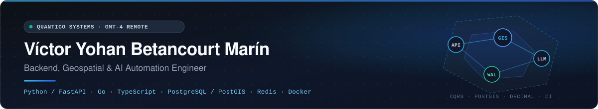

<picture>
  <source media="(prefers-color-scheme: dark)" srcset="assets/banner-dark.svg" />
  <source media="(prefers-color-scheme: light)" srcset="assets/banner-light.svg" />
  
</picture>

  <a href="README.md">English</a> · <strong>Español</strong>

  
  
  

Desarrollo sistemas POS/ERP multimoneda, asistentes comerciales sobre WhatsApp Business Cloud API, plataformas geoespaciales de campo y pipelines de datos en Python autoalojados a través de **[Quantico Systems](https://quanticosystems.com)**.

---

### Arquitectura Destacada — `quantico-censo`

<table>
  <tr>
    <td width="54%" valign="middle">
      
    </td>
    <td width="46%" valign="top">
      
<strong>Censo Comercial Geoespacial y PWA Offline de Campo</strong>

      

        
      

      <ul>
        <li><strong>CQRS detrás de Nginx:</strong> plano de escritura <code>backend-sync</code> + plano de lectura/WS <code>backend-read</code> enlazados vía Redis Pub/Sub.</li>
        <li><strong>Geocercas PostGIS:</strong> <code>ST_Covers</code> / <code>ST_Distance</code> con índices <code>GiST</code>, cuarentena por desvío GPS y bloqueos <code>FOR UPDATE</code>.</li>
        <li><strong>PWA móvil cifrada:</strong> TypeScript estricto + bóveda <code>PBKDF2-SHA256</code> / <code>AES-GCM-256</code> en Web Worker e <code>IndexedDB</code>.</li>
      </ul>
      

        
        
      

    </td>
  </tr>
</table>

---

### Repositorios de Backend y Automatización

<table>
  <tr>
    <td width="33.3%" valign="top">
      
<strong><a href="https://github.com/Mc3yohan/whatsapp-ai-handoff-engine">whatsapp-ai-handoff-engine</a></strong>

      

      
Servicio webhook en FastAPI para Meta WhatsApp Cloud API con verificación HMAC <code>X-Hub-Signature-256</code>, idempotencia atómica <code>wamid</code> en SQLite WAL, precios <code>Decimal</code>, rutas de operador con API-Key y traspaso humano determinista.

    </td>
    <td width="33.3%" valign="top">
      
<strong><a href="https://github.com/Mc3yohan/multicurrency-pos-ledger-api">multicurrency-pos-ledger-api</a></strong>

      

      
Motor contable POS multimoneda (<code>USD / VES / USDT</code>) con bloqueo de stock <code>BEGIN IMMEDIATE</code>, protección contra redondeo en cuotas, snapshots inmutables de tasa, aislamiento de márgenes por API-Key RBAC e importador CSV atómico.

    </td>
    <td width="33.3%" valign="top">
      
<strong><a href="https://github.com/Mc3yohan/python-ops-automation-pipeline">python-ops-automation-pipeline</a></strong>

      

      
Pipeline ETL y de alertas en Python sin dependencias externas con parseo estricto <code>Decimal</code>, deduplicación SHA-256 en SQLite WAL, cuarentena en CSV, imagen Docker no-root y webhooks JSON con reintentos.

    </td>
  </tr>
</table>

Los sistemas comerciales en producción de clientes bajo Quantico Systems se mantienen en repositorios privados; hay demos interactivas en vivo en <a href="https://quanticosystems.com">quanticosystems.com</a>.

---

### Contribuciones Open Source

| Pull Request | Estado | Alcance |
| :--- | :---: | :--- |
| **[hanzoai/cloud#58](https://github.com/hanzoai/cloud/pull/58)** |  | Benchmark en Go sin dependencias (`CGO_ENABLED=0`) para agentes empresariales con control dual, versionado CAS y 27 pruebas bajo `-race` |
| **[Get-Concord-AI/concord-mcp#388](https://github.com/Get-Concord-AI/concord-mcp/pull/388)** · **[#389](https://github.com/Get-Concord-AI/concord-mcp/pull/389)** |  | Correcciones en TypeScript/MCP para marcadores de cierre en Cursor y reasignación forzada de tareas huérfanas |
| **[prooflinedev/sdk-python#73](https://github.com/prooflinedev/sdk-python/pull/73)** |  | Paridad tipada en `ReviewFilters` (`audits`) contra la especificación OpenAPI en los clientes Python síncrono y asíncrono |

---

### Stack Principal

  
  
  
  
  
  
  
  
  
  
  
  

