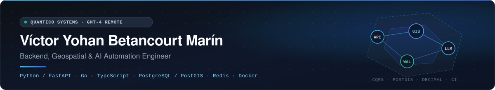

<picture>
  <source media="(prefers-color-scheme: dark)" srcset="assets/banner-dark.svg" />
  <source media="(prefers-color-scheme: light)" srcset="assets/banner-light.svg" />
  
</picture>

  <strong>English</strong> · <a href="README.es.md">Español</a>

  
  
  

I build multi-currency POS/ERP backends, WhatsApp Business Cloud API sales assistants, geospatial field platforms, and self-hosted Python data pipelines through **[Quantico Systems](https://quanticosystems.com)**.

---

### Featured Architecture — `quantico-censo`

<table>
  <tr>
    <td width="54%" valign="middle">
      
    </td>
    <td width="46%" valign="top">
      
<strong>Geospatial Retail Census &amp; Offline Field PWA</strong>

      

        
      

      <ul>
        <li><strong>CQRS split behind Nginx:</strong> <code>backend-sync</code> write plane + <code>backend-read</code> read/WS plane bridged via Redis Pub/Sub.</li>
        <li><strong>PostGIS geofencing:</strong> <code>ST_Covers</code> / <code>ST_Distance</code> with <code>GiST</code> indexes, GPS drift quarantine, and <code>FOR UPDATE</code> locking.</li>
        <li><strong>Offline encrypted PWA:</strong> Strict TypeScript + Web Worker <code>PBKDF2-SHA256</code> / <code>AES-GCM-256</code> vault in <code>IndexedDB</code>.</li>
      </ul>
      

        
        
      

    </td>
  </tr>
</table>

---

### Backend & Automation Repositories

<table>
  <tr>
    <td width="33.3%" valign="top">
      
<strong><a href="https://github.com/Mc3yohan/whatsapp-ai-handoff-engine">whatsapp-ai-handoff-engine</a></strong>

      

      
FastAPI Meta WhatsApp Cloud API webhook service with <code>X-Hub-Signature-256</code> HMAC checks, atomic SQLite WAL <code>wamid</code> idempotency, <code>Decimal</code> pricing, API-key operator routes, and deterministic human handoff.

    </td>
    <td width="33.3%" valign="top">
      
<strong><a href="https://github.com/Mc3yohan/multicurrency-pos-ledger-api">multicurrency-pos-ledger-api</a></strong>

      

      
Multi-currency POS ledger (<code>USD / VES / USDT</code>) with <code>BEGIN IMMEDIATE</code> stock locking, split-rounding defense, immutable rate snapshots, API-key RBAC margin isolation, and atomic CSV imports.

    </td>
    <td width="33.3%" valign="top">
      
<strong><a href="https://github.com/Mc3yohan/python-ops-automation-pipeline">python-ops-automation-pipeline</a></strong>

      

      
Zero-dependency Python ETL &amp; alerting pipeline with strict <code>Decimal</code> parsing, SHA-256 SQLite WAL deduplication, quarantine CSV exports, non-root Docker image, and retryable JSON webhooks.

    </td>
  </tr>
</table>

Client commercial systems built under Quantico Systems are maintained in private repositories; interactive demos are live at <a href="https://quanticosystems.com">quanticosystems.com</a>.

---

### Open Source Contributions

| Pull Request | Status | Scope |
| :--- | :---: | :--- |
| **[hanzoai/cloud#58](https://github.com/hanzoai/cloud/pull/58)** |  | Dependency-free Go (`CGO_ENABLED=0`) dual-control business-agent benchmark with CAS versioning and 27 race-tested cases |
| **[Get-Concord-AI/concord-mcp#388](https://github.com/Get-Concord-AI/concord-mcp/pull/388)** · **[#389](https://github.com/Get-Concord-AI/concord-mcp/pull/389)** |  | TypeScript/MCP fixes for Cursor stop-hook markers and forced recovery of stale tasks without a human owner |
| **[prooflinedev/sdk-python#73](https://github.com/prooflinedev/sdk-python/pull/73)** |  | Typed `ReviewFilters` OpenAPI parity (`audits` parameter) across sync and async Python SDK clients |

---

### Core Stack

  
  
  
  
  
  
  
  
  
  
  
  

